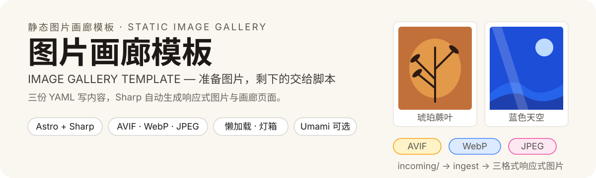

<p align="right"><a href="README.md">中文</a></p>

<p align="center">
  
</p>

<p align="center">
  <a href="https://xiaosang.cc/image-gallery-template/">▶ Live Demo</a>
  ·
  <a href="https://xiaosang.cc/image-gallery-template/guide">Features & Usage Guide</a>
  ·
  <a href="https://holynova.github.io/image-gallery-template/">GitHub Pages</a>
  ·
  <a href="https://github.com/holynova/image-gallery-template">GitHub Repository</a>
</p>

Image Gallery Template is an image-first, static-first gallery template you can build with AI: drop in your photos, fill in three YAML files, and the scripts generate responsive AVIF / WebP / JPEG images, gallery pages, and the static site. Good for photo collections, travel journals, portfolios, product galleries, and exhibition pages.

## Screenshot

<p align="center">
  
</p>

## Features

- **Sharp image processing**: automatically generates responsive AVIF, WebP, and JPEG versions, with multiple widths for thumbnails and lightbox images.
- **Gallery experience**: lazy loading, first-screen priority loading, batch rendering, collection filters, lightbox, keyboard and touch navigation.
- **Integrity validation**: checks that `alt` text, collections, sizes, hashes, and derived files are all present.
- **Optional analytics**: Umami page views plus image open/download/share events (works fine without it).
- **Originals kept out**: source images stay in `incoming/` and are never copied into the production output.
- **AI collaboration**: ships with a `.agents/skills/build-gallery` skill and `prompts/build-gallery.md`, so you can hand the whole build process to an AI.

## Quick Start

Requirements: Node.js ≥ 20.3, npm.

```bash
git clone https://github.com/holynova/image-gallery-template.git my-gallery
cd my-gallery
npm ci
```

**1. Add images** — drop source images into `incoming/`, with subdirectories per collection if you like. Supports AVIF, GIF, JPEG, PNG, SVG, TIFF, WebP.

```text
incoming/
  travel/
    mountain.jpg
    lake.png
  portraits/
    person.webp
```

**2. Write config** — maintain just three YAML files:

- `content/site.yml`: site title, feature toggles, image width and quality parameters.
- `content/collections.yml`: collections, each with a unique `id`.
- `content/images.yml`: image metadata; `source` matches a path under `incoming/`, and `alt` must not be empty.

```yaml
# content/images.yml
images:
  - source: "travel/mountain.jpg"
    collection: "travel"
    alt: "A mountain ridge in morning mist"
    caption: "Morning Ridge"
```

**3. Generate and check**:

```bash
npm run ingest    # Process originals, generate public/media and src/data/manifest.json
npm run validate  # Check config, image references, and derived files
npm run check     # Astro type and template checks
npm test          # Automated tests
npm run build     # Full build, output goes to dist/
```

**4. Preview locally**: `npm run dev` (development, default `http://localhost:4321/`), or `npm run preview` after building to preview the real static output.

**5. Publish**: a GitHub Pages workflow is built in — pushing to `master` builds and publishes automatically; pick GitHub Actions under the repo's Settings → Pages.

## Tech

- Astro + Sharp + Zod + TypeScript, fully static output, zero runtime services.
- The image pipeline lives in `scripts/`: `ingest.ts` processes originals, `validate.ts` checks integrity, `image-pipeline.ts` generates multi-format, multi-size derivatives.
- Config is validated by Zod schemas (`src/lib/schema.ts`); gallery interaction lives in `src/scripts/gallery.ts` (lazy loading, lightbox, keyboard navigation).

```
incoming/               Originals (in only, never shipped to production)
content/                Three YAML files: site / collections / images
scripts/                ingest / validate / image-pipeline / slug / config
src/pages/index.astro   Gallery homepage
src/components/         GalleryCard and other components
src/scripts/gallery.ts  Gallery interaction: lazy loading, lightbox, keyboard & touch navigation
src/lib/                Schema validation, paths, analytics
public/media/           Generated output: multi-format, multi-size derivatives (do not edit by hand)
tests/                  Pipeline / schema / slug tests (vitest)
.agents/skills/         build-gallery skill: AI builds the site by the book
```

## License

MIT, see `LICENSE`.
