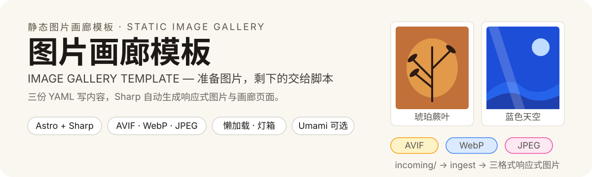
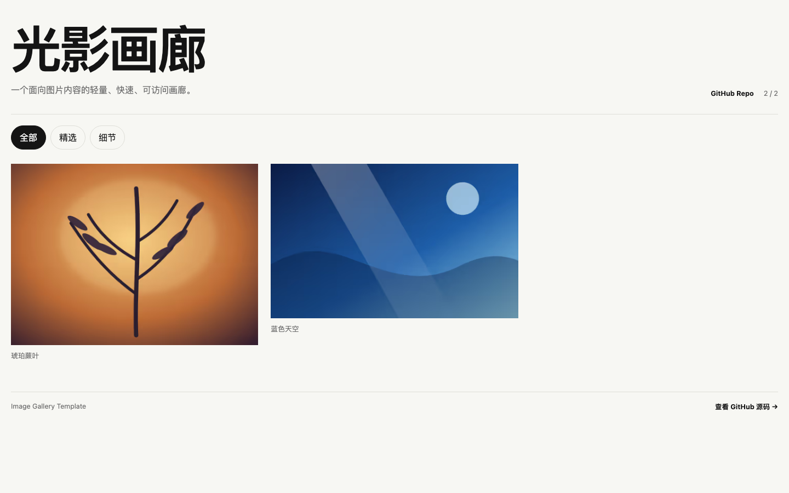

<p align="right"><a href="README.en.md">English</a></p>

<p align="center">
  
</p>

<p align="center">
  <a href="https://xiaosang.cc/image-gallery-template/">▶ 在线示例</a>
  ·
  <a href="https://xiaosang.cc/image-gallery-template/guide">功能与用法说明</a>
  ·
  <a href="https://holynova.github.io/image-gallery-template/">GitHub Pages</a>
  ·
  <a href="https://github.com/holynova/image-gallery-template">GitHub 仓库</a>
</p>

图片画廊模板是一个「图片优先、静态优先、AI 可协作」的图片网站模板：你只需要准备图片和三份内容配置，脚本就会自动生成响应式的 AVIF / WebP / JPEG 图片、画廊页面和静态产物。适合摄影集、旅行记录、作品集、产品图库、展览页面。

## 截图

<p align="center">
  
</p>

## 内置能力

- **Sharp 图片处理**：自动生成 AVIF、WebP、JPEG 响应式版本，缩略图与灯箱大图多档宽度。
- **画廊体验**：图片懒加载、首屏优先加载、批量渲染、栏目筛选、灯箱、键盘与触摸导航。
- **完整性校验**：检查 `alt`、栏目、尺寸、哈希与派生文件是否齐全。
- **可选统计**：Umami 访问统计与图片打开、下载、分享事件（不配也能正常运行）。
- **原图隔离**：原图只留在 `incoming/`，不会被复制到线上产物里。
- **AI 协作**：内置 `.agents/skills/build-gallery` 技能与 `prompts/build-gallery.md`，可交给 AI 按流程建站。

## 快速上手

环境要求：Node.js ≥ 20.3、npm。

```bash
git clone https://github.com/holynova/image-gallery-template.git my-gallery
cd my-gallery
npm ci
```

**1. 放图片** — 把原图放到 `incoming/`，可按栏目建子目录。支持 AVIF、GIF、JPEG、PNG、SVG、TIFF、WebP。

```text
incoming/
  travel/
    mountain.jpg
    lake.png
  portraits/
    person.webp
```

**2. 写配置** — 只维护三个 YAML 文件：

- `content/site.yml`：站点标题、功能开关、图片宽度与质量参数。
- `content/collections.yml`：栏目，每个 `id` 唯一。
- `content/images.yml`：图片元数据，`source` 对应 `incoming/` 内路径，`alt` 不能为空。

```yaml
# content/images.yml
images:
  - source: "travel/mountain.jpg"
    collection: "travel"
    alt: "清晨云雾中的山脊"
    caption: "清晨山脊"
```

**3. 生成与检查**：

```bash
npm run ingest    # 处理原图，生成 public/media 与 src/data/manifest.json
npm run validate  # 检查配置、图片引用与派生文件
npm run check     # Astro 类型与模板检查
npm test          # 自动化测试
npm run build     # 完整构建，产物写入 dist/
```

**4. 本地预览**：`npm run dev`（开发，默认 `http://localhost:4321/`），或构建后 `npm run preview` 预览真正的静态产物。

**5. 发布**：内置 GitHub Pages 工作流，推送到 `master` 即自动构建发布；在仓库 Settings → Pages 选择 GitHub Actions 即可。

## 技术

- Astro + Sharp + Zod + TypeScript，纯静态输出，零运行时服务。
- 图片管线在 `scripts/`：`ingest.ts` 处理原图、`validate.ts` 做完整性校验、`image-pipeline.ts` 生成多格式多尺寸派生图。
- 配置经 Zod schema 校验（`src/lib/schema.ts`）；画廊交互在 `src/scripts/gallery.ts`（懒加载、灯箱、键盘导航）。

```
incoming/               原图（只进不出，不进线上产物）
content/                三份 YAML：site / collections / images
scripts/                ingest / validate / image-pipeline / slug / config
src/pages/index.astro   画廊首页
src/components/         GalleryCard 等组件
src/scripts/gallery.ts  画廊交互：懒加载、灯箱、键盘与触摸导航
src/lib/                schema 校验、路径、统计
public/media/           生成物：多格式多尺寸派生图（勿手工编辑）
tests/                  pipeline / schema / slug 测试（vitest）
.agents/skills/         build-gallery 技能：AI 按流程建站
```

## 许可

MIT，见 `LICENSE`。
